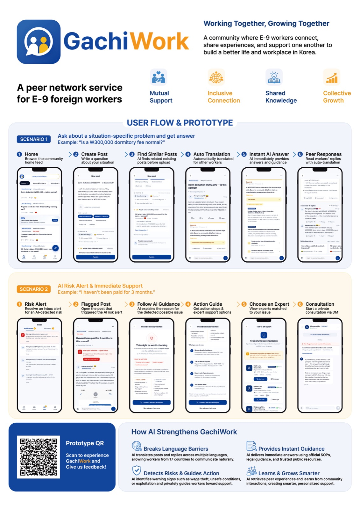

# GachiWork 가치워크

Kyungjin Bae 배경진 (team lead), with a team of 4 from Korea, France and Indonesia. Mobile app, 2026

A multilingual peer community for E‑9 migrant workers in Korea. Workers ask in their own language, and the question reaches peers from other countries who do the same work, with law-based official answers on the same screen.

**[Try the prototype](https://kellyb1024.github.io/GachiWork/prototype/GachiWork_Prototype_final.html)**, **[Watch the intro video](https://youtu.be/tj8lc2Q7Pas)**, **[Read the case study](https://kellyb1024.github.io/en/gachiwork.html)**

## Problem

- 340,000 migrant workers on E‑9 visas in factories and farms, tied to assigned workplaces and scattered across the country
- Dorm fees come out of their pay, with no coworker to ask what others pay
- Hard to tell whether what they face is common practice or illegal

## Solution

- Questions asked in one's native language, translated and sent to peers from other countries doing the same work
- Peer answers and law-based official answers on one screen
- When risks like unpaid wages are suspected, an alert to the user and a direct link to an expert inside the app

## Process

- Surveyed 86 newly arrived E‑9 workers at the Korea Labor Foundation's Yeoju training center. 85% knew no peers outside their workplace
- Existing social media communities split by country, not industry, leaving workers from smaller countries out. So we grouped people by industry, not country
- 4 rounds of user testing. For serious issues users wanted official information first, so answers were reordered to official info, then peer experience

## Result

- Grand Prize (Teacher's Pick), Yonsei TAP Capstone
- Selected for the Yonsei IHEI Social Innovation Town workstation
- App prototype covering one flow, from question to expert connection

## My role

- As team lead, led the work from service planning to UX/UI design and prototype development
- Research design, scheduling, partnership prep with the Korea Labor Foundation
- Video, presentation deck, poster

---

한국에서 일하는 E‑9 외국인 노동자를 위한 다국어 동료 커뮤니티. 모국어로 질문하면 번역되어 같은 일을 하는 다른 나라 동료에게 전달되고, 동료들의 답변과 법 기반 공식 답변을 한 화면에서 볼 수 있다. 연세대 TAP Capstone 대상(Teacher's Pick), 연세대 고등교육혁신원 워크스테이션 선정.
